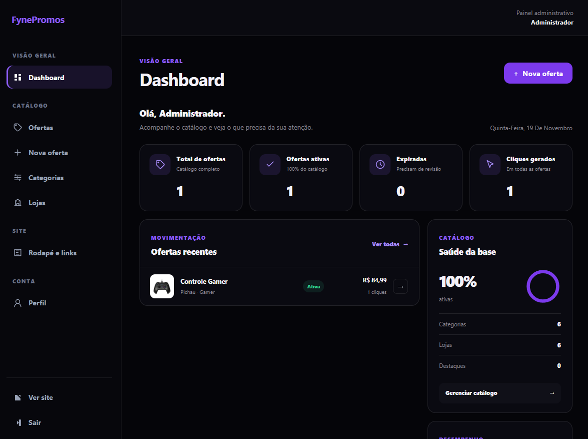
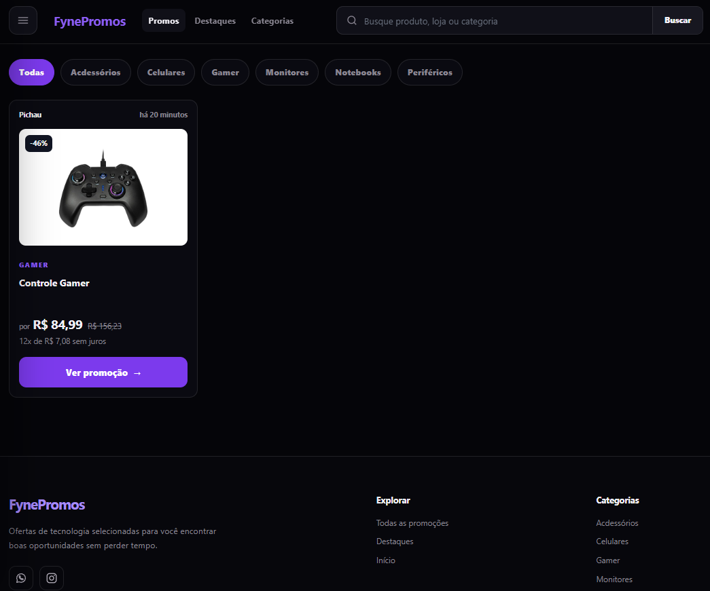
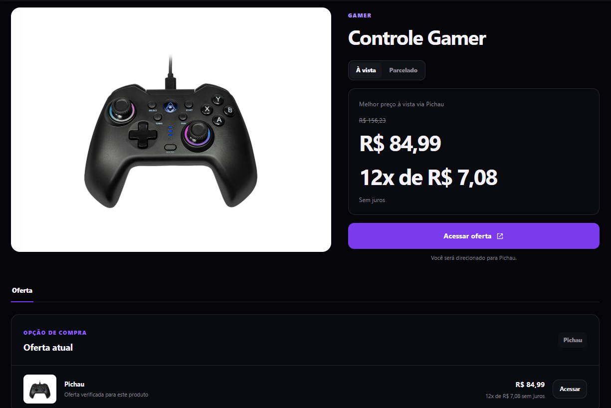

# FynePromos

Catálogo simples de promoções de tecnologia, mantido manualmente. O projeto reúne ofertas de notebooks, celulares, periféricos, monitores e produtos gamer, sempre direcionando o visitante para a loja de compra.

## Stack

- Laravel 12
- PHP 8.2+
- MySQL
- Blade, CSS e JavaScript estáticos
- Laravel Breeze para autenticação

## Funcionalidades

- Página pública com ofertas ativas
- Busca por nome, categoria e loja
- Página detalhada da oferta
- Redirecionamento para a loja com contagem de cliques
- Expiração automática por data
- Painel autenticado para criar, editar e remover ofertas
- Categorias e lojas iniciais via seeders

## Instalação

```bash
git clone https://github.com/yjtank/fynepromos.git
cd fynepromos
composer install
copy .env.example .env
php artisan key:generate
```

Configure a conexão MySQL no `.env`:

```env
DB_CONNECTION=mysql
DB_HOST=127.0.0.1
DB_PORT=3306
DB_DATABASE=fynepromos
DB_USERNAME=root
DB_PASSWORD=
```

Depois execute:

```bash
php artisan migrate --seed
php artisan storage:link
php artisan serve
```

Acesse `http://127.0.0.1:8000`.

## Acesso administrativo local

```text
E-mail: admin@fynepromos.test
Senha: password
```

Altere a senha antes de publicar o projeto.

## Fluxo de cadastro

1. Entre em `/login`.
2. Acesse **Ofertas > Nova oferta**.
3. Preencha produto, categoria, loja, preço e link de compra.
4. Use a validade para ocultar automaticamente uma promoção expirada.
5. O botão público passa pelo rastreador de cliques antes de redirecionar para a loja.

## Demonstração

### Dashboard administrativo



### Página inicial pública



### Detalhes do produto



## Licença

Projeto de estudo publicado sob a licença MIT.
